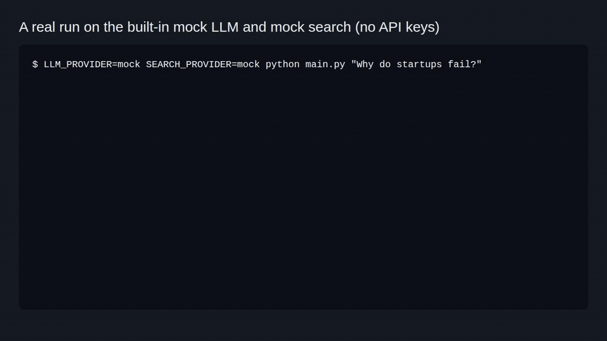

# Revolu Idea



A research CLI that turns a question into cause-and-effect claims and makes agents argue each one.

```bash
git clone https://github.com/jayhemnani9910/revolu-idea.git && cd revolu-idea && pip install -r requirements.txt
```

[](https://github.com/jayhemnani9910/revolu-idea/actions/workflows/ci.yml)

Landing page with an in-browser sample run: https://jayhemnani9910.github.io/revolu-idea/

## Try it

No keys needed. This runs the whole graph on the built-in mock LLM and mock search, like the GIF above:

```bash
LLM_PROVIDER=mock SEARCH_PROVIDER=mock python main.py "Why do startups fail?"
```

For a real run, copy the env template, set `LLM_API_KEY`, and pick a search provider:

```bash
cp .env.example .env
python main.py "What are the latest developments in quantum computing?"
python main.py "your topic" --model gpt-4o
```

The report lands in `output/reports/` as `.md` and `.json`.

## How it works

CAG stands for causal-adversarial graph. It runs as a LangGraph state graph:

```
User query
    ↓
[Planner]   builds a DAG of variables and cause-effect edges
    ↓
[Auditor]   checks depth and loop limits
    ↓
[Selector]  picks the next unresolved edge
    ↓
[Adversary + Supporter]  search against and for the edge, at the same time
    ↓
[Judge]     marks the edge VERIFIED, FALSIFIED or UNCLEAR with a confidence, back to the Auditor
    ↓  (no edges left, or depth reached)
[Writer]    output/reports/*.md and .json
```

The adversary (red team) looks for evidence that the link is wrong. The supporter (blue team) looks for evidence that it holds. The two run in parallel with `asyncio.gather`. The judge reads both piles and gives a verdict. An edge left UNCLEAR can be picked again, up to `MAX_INVESTIGATIONS_PER_EDGE` times.

The report has a summary, sections with verdict-tagged findings, a block per causal edge (claim, status, evidence counts, judge reasoning), the method, run stats and limitations.

## Configuration

Everything is read from `.env` (see `.env.example`).

| Variable | What it does |
|----------|--------------|
| `LLM_PROVIDER` | `github`, `groq`, `deepseek`, any OpenAI-compatible name, or `mock` |
| `LLM_BASE_URL` | OpenAI-compatible endpoint, e.g. `https://models.inference.ai.azure.com` or `https://api.groq.com/openai/v1` |
| `LLM_MODEL` | One model, a comma-separated list, or `auto` for the built-in pool (groq and github only) |
| `LLM_API_KEY` | Key for the LLM endpoint. For GitHub Models, a token with `models:read` |
| `SEARCH_PROVIDER` | `tavily`, `exa`, `duckduckgo` or `mock`. One provider per run |
| `TAVILY_API_KEY`, `EXA_API_KEY` | Keys for those search providers. DuckDuckGo needs none |
| `MAX_RECURSION_DEPTH` | Edge investigations before the writer runs (default 5). Not graph depth |
| `MAX_INVESTIGATIONS_PER_EDGE` | How often one edge can be retried (default 2) |
| `OUTPUT_DIR` | Where reports go (default `output`) |

With a list of models, or `auto`, each run starts on the next model in the list and falls back to the others if a call fails. DuckDuckGo falls back to Wikipedia when it returns nothing.

## Layout

Ports and adapters. The agents only talk to the interfaces in `ports/`.

```
domain/      models.py, causal_models.py, exceptions.py
ports/       llm.py, search.py, storage.py
adapters/    openai_compatible, fallback_llm, tavily, exa, duckduckgo, mock, local_storage
agents/      state.py, nodes/ (causal_planner, edge_selector, adversary, supporter, judge, auditor, writer)
graph/       cag_graph.py, the LangGraph workflow
config/      settings.py
container.py wires the providers together
main.py      CLI entry point
```

## Development

```bash
pip install pytest ruff
ruff check .
python -m pytest -q
```

The test runs the full graph on the mocks, so it needs no keys or network. See [CONTRIBUTING.md](CONTRIBUTING.md).

This is an experiment. Expect rough edges.

## License

[MIT](LICENSE)
